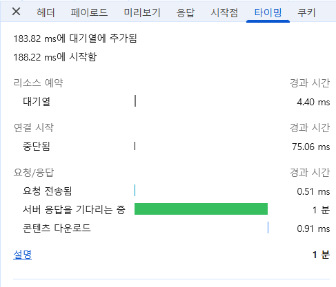
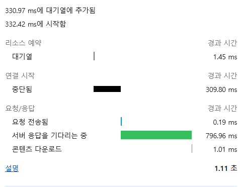

# ES 조회 속도 Transform 롤업으로 개선

회사에서 시계열 데이터를 시간 단위로 집계해서 차트로 보여주는 화면이 있는데, 조회가 너무 느려서 고친 걸 정리해둔다.

고친 건 세 단계였다. 인덱스를 좁히고, 집계 방식을 바꾸고, 마지막에 롤업 인덱스를 만들었다. 롤업이 제일 효과가 컸지만 앞의 두 개가 없으면 롤업만으로도 안 됐다.

## 뭐가 문제였냐면

네트워크 통신 통계를 분 단위로 ES에 쌓고 있었고, 화면에서는 그걸 시간 단위로 묶어서 차트로 보여주고 있었다.

필터에 출발지 IP랑 포트를 넣고 조회하는데,

- 단일 IP + 단일 포트로 조회하면 빠르다.
- 근데 서브넷(대역)이랑 포트 여러 개를 같이 조회하니까 수 초에서 수십 초까지 걸리더라.

처음엔 왜 이렇게 차이가 나는지 감이 안 왔다.

## 원인은 문서 수였다

파고 보니까 결국 ES가 읽어야 하는 문서 건수 문제였다.

문서를 구분하는 hashkey에 `src_port`(출발지 포트)가 조합으로 들어가 있었는데, 클라이언트는 같은 서비스로 통신해도 연결할 때마다 src_port가 새로 열린다. 그래서 같은 서비스 통신이어도 연결한 횟수만큼 문서가 N개로 쪼개져서 저장되고 있었던 거다.

```
같은 서비스 통신 (A -> B, dst_port 443)
  연결1 -> src_port 51001 -> 문서 1개
  연결2 -> src_port 51002 -> 문서 1개
  연결3 -> src_port 51003 -> 문서 1개
  ...
서비스는 하난데 문서만 계속 쌓임
```

여기에 원본이 분 단위로 쌓이니까, 서브넷처럼 범위가 넓어지면 읽어야 할 문서가 확 늘어난다. 화면은 시간 단위로 합계를 내야 하는데 그러려면 이 많은 문서를 다 훑어야 하니까 오래 걸린 거였다. 단일 IP/포트가 빨랐던 건 읽을 문서가 적어서였고.

### 그래서 doc_count 는 쓸 수 없다

이걸 알고 나서 집계를 다시 봤다. 수집기가 분 단위로 **upsert** 를 하는 구조고, 각 문서의 `packetTotalCount` 가 "그 1분 그 조합의 누적 패킷 수"다.

그러니까 `doc_count` 는 패킷 수가 아니다. **"통신이 발생한 분의 개수"** 다.

```
doc_count = 3        → 3분 동안 통신이 있었다
SUM(packetTotalCount) = 48,120  → 실제 패킷은 4만 8천 개
```

둘이 의미가 완전히 다르다. 버킷마다 `doc_count` 를 쓰면 숫자가 그냥 틀린다. 그래서 모든 카운트 지표를 `SUM(packetTotalCount)` 로 뽑도록 바꿨다.

집계를 짤 때 "몇 건이냐"를 `doc_count` 로 세는 게 반사적인데, **문서 하나가 뭘 뜻하는지**에 따라 그게 답이 아닐 수 있다. upsert 로 쌓는 집계 인덱스는 특히 그렇다.

## 1차 — 인덱스를 좁혔다

인덱스는 일자별로 만들어지고 있었다. `comm_stats-2026-08-06`, `comm_stats-2026-08-07` ... 이런 식.

조회할 때는 와일드카드로 한 번에 넘겼다.

```java
.index("comm_stats-*")
```

이게 느린 이유를 처음엔 몰랐다. "어차피 range 필터로 기간을 거는데 왜 느리지?" 싶었다.

**range 필터는 샤드를 연 뒤에 걸러내는 단계라서 인덱스 선택에는 영향이 없다.** 와일드카드를 쓰면 운영 시작 이래 쌓인 **전체 일자 인덱스의 샤드를 다 연다.** 그 다음에 기간 필터로 버린다. 1년치가 쌓여 있으면 365개 인덱스를 열고 하루치만 쓴다.

그래서 인덱스 이름 목록을 직접 만들어서 넘기게 바꿨다.

```java
List<String> searchIndices = ElasticChartUtil.dailyIndices("comm_stats-*", startMillis, endMillis);
// → ["comm_stats-2026-08-05", "comm_stats-2026-08-06", "comm_stats-2026-08-07"]

client.search(s -> s
        .index(searchIndices)
        .ignoreUnavailable(true)    // 그 날짜 인덱스가 없을 수 있다
        .allowNoIndices(true)
        ...);
```

만들면서 걸린 게 세 개 있었다.

**자정 경계** — 색인하는 날짜랑 문서의 `timestamp` 가 자정에서 어긋날 수 있다. 수집 배치가 자정을 걸치면 문서가 자기 날짜보다 이른/늦은 인덱스에 들어간다. 그래서 앞뒤로 하루씩 여유를 뒀다.

```java
LocalDate day  = ...toLocalDate().minusDays(1);   // 하루 앞
LocalDate last = ...toLocalDate().plusDays(1);    // 하루 뒤
```

**URL 길이** — 구간이 길면 인덱스 이름이 수백 개가 된다. 이름을 전부 나열하면 요청 URL이 터진다. 그래서 **완전히 포함된 달은 월 와일드카드로 묶었다.**

```java
if (day.getDayOfMonth() == 1 && !monthEnd.isAfter(last)) {
    indices.add(prefix + day.format(INDEX_MONTH_FORMATTER) + "-*");   // comm_stats-2026-07-*
    day = monthEnd.plusDays(1);
} else {
    indices.add(prefix + day.format(INDEX_DAY_FORMATTER));            // comm_stats-2026-08-06
    day = day.plusDays(1);
}
```

6월 15일 ~ 8월 6일이면 7월은 통째로 포함되니까 `comm_stats-2026-07-*` 하나로 쓰고, 6월·8월은 날짜별로 적는다.

**파싱 실패 폴백** — 기간 문자열 형식이 여러 개라 파싱이 실패할 수 있다. 실패하면 와일드카드를 그대로 돌려준다.

```java
if (startMillis <= 0 || endMillis <= 0 || endMillis < startMillis) {
    indices.add(indexPattern);   // comm_stats-* 로 폴백
    return indices;
}
```

느린 쪽으로 폴백하는 거다. 느린 게 안 나오는 것보다는 낫다는 판단인데, 이러면 **느려도 원인을 모른다**. 조용히 와일드카드로 돌아가 있으니까. 로그를 남겨야 했던 것 같다.

효과는 있었는데 원본 문서 수 자체가 많아서 이것만으로는 부족했다.

## 2차 — 집계 방식을 바꿨다 (multi_terms → composite)

프로파일을 떠보니 **`multi_terms` 하나가 조회 시간의 99%** 였다. 이게 제일 의외였다.

출발지 IP · 목적지 IP · 포트 · 프로토콜 네 개를 조합해서 상위 통신을 뽑는 집계였다.

```java
// 이렇게 썼었다
.multiTerms(mt -> mt.terms(srcIp, dstIp, port, protocol))
```

`terms` 집계는 빠르다. **global ordinals** 라는 걸 쓰기 때문이다. keyword 필드는 세그먼트마다 값들을 사전순으로 정렬해서 번호를 매겨두고, 집계할 때 문자열이 아니라 그 번호로 센다.

`multi_terms` 는 그걸 못 쓴다. 조합 키는 미리 만들어둘 수 없으니까 **문서마다 네 필드를 꺼내서 키를 조립한다.** 문서가 수백만 개면 수백만 번 문자열을 합친다.

```
terms:        미리 매긴 번호로 센다            → 빠르다
multi_terms:  doc 마다 "a|b|c|d" 를 만든다     → doc 수에 정비례
```

`composite` 로 바꿨다. `composite` 는 여러 소스를 조합하면서 **페이지로 끊어서** 돌려준다.

```java
List<Map<String, CompositeAggregationSource>> sources = new ArrayList<>();
sources.add(Map.of("srcIp",    CompositeAggregationSource.of(s -> s.terms(t -> t.field(fields.getSrcIpStr())))));
sources.add(Map.of("dstIp",    CompositeAggregationSource.of(s -> s.terms(t -> t.field(fields.getDstIpStr())))));
sources.add(Map.of("port",     CompositeAggregationSource.of(s -> s.terms(t -> t.field(fields.getServerPort())))));
sources.add(Map.of("protocol", CompositeAggregationSource.of(s -> s.terms(t -> t.field(fields.getProtocolDetail())))));
```

### 근데 composite 는 정렬을 못 한다

`composite` 는 **하위 집계 기준으로 정렬이 안 된다.** 키 순서로만 준다. 나는 "패킷 합계 상위 N"이 필요한데 그걸 ES가 못 해준다.

그래서 전수 열거하고 애플리케이션에서 정렬했다.

```java
while (aggregate != null && aggregate.isComposite()) {
    List<CompositeBucket> buckets = composite.buckets().array();
    mergePairBuckets(merged, buckets);           // 다 모은다
    Map<String, FieldValue> afterKey = composite.afterKey();
    if (afterKey == null || buckets.size() < PAGE_SIZE || page >= MAX_PAGES) break;
    // afterKey 로 다음 페이지
}
// 모은 다음 앱에서 패킷 합계로 정렬해서 상위 N
```

번거로워 보이는데 **얻은 것도 있다.** `terms` 는 샤드마다 상위 N을 뽑아서 합치는 구조라 결과가 **근사치**다. 샤드 경계에서 진짜 상위가 빠질 수 있다. 전수 열거는 정확하다.

| | terms / multi_terms | composite 전수 열거 |
|---|---|---|
| 정렬 | ES가 해준다 | 앱에서 해야 한다 |
| 상위 N | 샤드 근사치 | 정확 |
| 속도 | multi_terms 는 doc 수에 비례 | 페이지 왕복은 있지만 훨씬 빠름 |

대신 조합이 폭증하면 전수 열거가 끝나지 않는다. 그래서 상한을 뒀다.

```java
private static final int TOP_PAIRS_PAGE_SIZE = 6000;
private static final int TOP_PAIRS_MAX_PAGES = 3;
...
if (afterKey != null && buckets.size() >= TOP_PAIRS_PAGE_SIZE) {
    logger.warn("Top 매칭 통신 조합이 페이지 상한({}회 x {}) 을 넘어 일부만 집계", TOP_PAIRS_MAX_PAGES, TOP_PAIRS_PAGE_SIZE);
}
```

상한을 걸면 결과가 부분이 된다. **그걸 로그로 남기는 게 중요했다.** 안 남기면 "상위 N"이 사실은 "18000개만 보고 뽑은 상위 N"인데 아무도 모른다. 숫자가 그럴듯하게 나오니까 더 위험하다.

### 비싼 집계는 걷어냈다

같이 돌던 집계 두 개를 없앴다.

- 커버리지(매칭 IP 수)는 문서마다 방향(정방향/역방향)을 재평가하는 쿼리였다. 제일 비쌌다.
- 서비스 수는 `cardinality` 로 셌는데 **그건 근사치**다. 정확한 값이 필요한 자리였다.

둘 다 **이미 가져온 `composite` 결과에서 파생**시켰다. 조합 목록이 손에 있으니 거기서 출발지 집합·목적지 집합·서비스 수를 세면 된다. ES를 두 번 부를 이유가 없었다.

응답 크기도 줄였다. 상위 통신 기본 개수가 10000이었는데 고트래픽 구간에서 응답이 폭증해 프론트가 렉이 걸렸다. 200으로 내렸다. **집계가 빨라져도 응답이 크면 느리게 느껨진다.**

## 3차 — ES Transform으로 롤업

여기까지 해도 원본 문서 수는 그대로다. 그래서 ES Transform을 써서 분 단위 원본을 시간 단위로 미리 집계한 롤업 인덱스를 따로 만들었다. 원본은 그대로 두고 집계 인덱스를 추가하는 방식이라 부담이 적었다.

분 단위를 시간 단위로 압축하니까 문서 수랑 용량이 확 줄었고, 조회할 때 원본 대신 이 롤업 인덱스를 읽으면 이미 시간별로 집계돼 있어서 스캔할 문서가 훨씬 적다.

Transform은 대충 이런 식으로 생겼다.

```json
PUT _transform/comm_stats_hourly
{
  "source": { "index": "comm_stats-*" },
  "dest":   { "index": "comm_stats_hourly" },
  "pivot": {
    "group_by": {
      "hourStartDate": {
        "date_histogram": { "field": "timestamp", "calendar_interval": "1h" }
      },
      "srcIpStr":       { "terms": { "field": "srcIpStr.keyword" } },
      "dstIpStr":       { "terms": { "field": "dstIpStr.keyword" } },
      "serverPort":     { "terms": { "field": "serverPort.keyword" } }
    },
    "aggregations": {
      "packetTotalCount": { "sum": { "field": "packetTotalCount" } },
      "lastStartTime":    { "max": { "field": "timestamp" } },
      "sessionCount":     { "value_count": { "field": "srcPort.keyword" } }
    }
  },
  "sync": { "time": { "field": "timestamp", "delay": "60s" } }
}
```

`group_by` 에 시간이랑 의미 있는 키만 넣고, 문제였던 `src_port` 는 뺐다. 대신 세션 수가 필요하면 `value_count` 로 개수만 세서 집계값으로 남긴다.

`sync.time` 을 주면 continuous transform이 돼서 새로 들어오는 데이터도 주기적으로 알아서 집계해준다. `delay` 는 색인 지연을 감안한 여유다. 이걸 너무 짧게 주면 아직 안 들어온 문서를 빼고 집계한다.

## 롤업 인덱스는 원본과 다르게 생겼다

이게 제일 손이 많이 간 부분이었다. "인덱스 이름만 바꿔 끼우면 되겠지" 했는데 아니었다.

**필드 타입이 다르다.** 원본은 `text` + `.keyword` 멀티필드로 매핑돼 있어서 집계할 때 `.keyword` 를 붙여야 한다. 그런데 Transform이 만든 롤업 인덱스는 **`keyword` 로 직접 매핑**된다. 접미를 붙이면 필드가 없다고 나온다.

**시간축 이름도 다르다.** `group_by` 에 붙인 이름이 그대로 필드명이 되니까 `timestamp` 가 아니라 `hourStartDate` 다. 마지막 활동 시각을 뽑던 `max(timestamp)` 도 롤업에서는 집계값 `lastStartTime` 을 읽어야 한다.

```
원본  comm_stats-2026-08-06      srcIpStr.keyword   timestamp       max(timestamp)
롤업  comm_stats_hourly-2026-08  srcIpStr           hourStartDate   lastStartTime
```

**인덱스 단위도 다르다.** 원본은 일별인데 롤업은 월별로 만들었다. 시간 단위로 압축되니 한 달을 한 인덱스에 담아도 크지 않다. 그래서 인덱스 목록 만드는 함수도 따로 필요했다.

```java
if (useRollup) {
    searchIndices = ElasticChartUtil.monthlyIndices(HOURLY_INDEX, startMillis, endMillis);
} else {
    searchIndices = ElasticChartUtil.dailyIndices(RAW_INDEX, startMillis, endMillis);
}
```

월별은 자정 경계 여유가 필요 없다. 어긋나도 같은 달 안이니까.

차이가 네 군데라 조회 코드에 `if (useRollup)` 이 흩어졌다. 그래서 **필드명 묶음을 VO로 뽑았다.**

```java
public class PolicyStatsIndexVo {
    private String prefix;
    private String srcIpStr;
    private String dstIpStr;
    private String serverPort;
    private String timeField;      // 기간 필터 · date_histogram 용
    private String lastTimeField;  // 마지막 매칭 시각 (max 집계)
    private boolean rollup;

    public PolicyStatsIndexVo(String prefix, String suffix, String timeField, String lastTimeField, boolean rollup) {
        this.prefix   = prefix;
        this.srcIpStr = "srcIpStr" + suffix;      // 원본은 ".keyword", 롤업은 ""
        ...
    }

    public static PolicyStatsIndexVo raw() {
        return new PolicyStatsIndexVo("comm_stats-", ".keyword", "timestamp", "timestamp", false);
    }
    public static PolicyStatsIndexVo rollup() {
        return new PolicyStatsIndexVo("comm_stats_hourly-", "", "hourStartDate", "lastStartTime", true);
    }
}
```

쿼리 코드는 `fields.getSrcIpStr()` 만 부르면 되고 접미가 뭔지 모른다. 분기가 생성자 두 개로 모였다.

**롤업으로 바꾸는 작업의 절반이 필드명 맞추는 거였다.** 집계를 미리 해두는 건 Transform이 해주는데, 그 결과물이 원본과 다른 모양이라는 건 아무도 안 알려준다.

## 정시로 안 맞추면 경계가 어긋난다

롤업은 1시간 버킷이다. 버킷의 시작 시각은 정시다.

조회 구간을 `14:30 ~ 16:30` 으로 주면, 롤업 인덱스에는 `14:00`, `15:00`, `16:00` 버킷만 있다. range 필터가 `hourStartDate >= 14:30` 이면 **14시 버킷이 빠진다.** 14:30~15:00 사이 데이터가 14시 버킷에 들어 있는데 통째로 날아간다.

```
실제 데이터:   [14:00 버킷]   [15:00 버킷]   [16:00 버킷]
조회 14:30~:                  ✓             ✓          ← 14시 버킷 누락
조회 14:00~:    ✓             ✓             ✓
```

그래서 롤업을 쓸 때는 구간을 정시로 내린다.

```java
if (useRollup) {
    startTime = ElasticChartUtil.floorToHour(startTime);
    endTime   = ElasticChartUtil.floorToHour(endTime);
}
```

```java
public static String floorToHour(String value) {
    long millis = parseMillis(value);
    if (millis <= 0) return value;
    return Instant.ofEpochMilli(millis).atZone(KOREA_ZONE).toLocalDateTime()
            .truncatedTo(ChronoUnit.HOURS)
            .format(DateTimeFormatter.ofPattern("yyyy-MM-dd HH:mm"));
}
```

사전 집계를 쓰면 **조회 구간의 해상도가 집계 단위에 묶인다.** 시간 롤업을 쓰는 순간 "14:30부터"라는 요청은 의미가 없어진다. 14시부터거나 15시부터다. 공짜로 빨라지는 게 아니라 정밀도를 내주고 바꾸는 거다.

## 켜고 끌 수 있게 뒀다

롤업 Transform이 없는 환경이 있다. 그래서 원본 조회 경로를 지우지 않고 프로퍼티로 뒀다.

```xml
<!-- ES 조회를 시간 롤업 인덱스로 전환 · 롤업 Transform 이 있는 환경에서만 true -->
<entry key="es.useRollup">true</entry>
```

```java
@Value("#{Common['es.useRollup']}")
private boolean useRollup;
```

이게 필드명을 VO로 추상화해야 했던 진짜 이유다. 롤업으로 완전히 갈아탈 거면 코드를 그냥 고치면 된다. 근데 **양쪽 다 동작해야** 하니까 차이를 한 곳에 모아야 했다.

대가도 있다. 두 경로를 다 유지하니까 한쪽만 고치면 다른 쪽이 조용히 틀린다. 끌 수 있게 만드는 건 안전한 선택인데 테스트할 경우가 두 배가 된다.

## 얼마나 빨라졌냐

서브넷 + 다중 포트로 무겁게 조회하는 같은 조건에서 비교했다. 개발자 도구 Network 타이밍 탭으로 잰 거다.

- 개선 전: 서버 응답 대기만 1분 넘게 걸림
- 개선 후: 같은 조회가 1.11초 (서버 응답 대기 약 797ms)

| 개선 전 | 개선 후 |
|---|---|
|  |  |

세 단계가 각각 얼마씩 줄였는지는 따로 안 쟀다. 지금 생각하면 단계마다 재놨어야 했다. `multi_terms` 가 99%였다는 건 프로파일로 확인했으니 2차가 컸을 것 같은데, 추측이다.

## 느낀 점

- 조회 느릴 때 쿼리만 붙잡고 있었는데, 결국 읽어야 하는 문서 수가 많으면 쿼리 튜닝만으로는 답이 없다. 데이터를 어떻게 쪼개서 저장하고 있는지(뭘 문서 키로 두는지)를 봐야 했다.
- src_port처럼 값이 매번 바뀌는 필드를 문서 키 조합에 넣으면 문서가 걷잡을 수 없이 늘어난다. 집계용이면 이런 건 키에서 빼는 게 맞다.
- **range 필터가 인덱스를 줄여주지 않는다.** 와일드카드는 샤드를 다 열고 나서 거른다. 기간을 걸었으니 괜찮을 거라고 생각한 게 틀렸다.
- **집계 종류 하나가 전체의 99%일 수 있다.** `multi_terms` 가 느린 이유(global ordinals를 못 쓴다)는 쓸 때 생각 못 했다. 편해 보이는 집계가 doc 수에 정비례하는 비용일 수 있다.
- **`doc_count` 가 뭘 세는지 확인해야 한다.** upsert 로 쌓는 인덱스에서는 문서 수가 사건 수가 아니다.
- 사전 집계는 **정밀도를 내주고 속도를 사는 거다.** 시간 롤업을 쓰면 분 단위 조회가 불가능해진다. 공짜가 아니다.
- 롤업 인덱스는 원본과 **다른 모양**이다. 필드 타입·시간축 이름·인덱스 단위가 다 다르다. 인덱스만 갈아끼우는 작업이 아니다.
- 상한을 걸어서 부분 결과가 되면 **반드시 로그를 남겨야 한다.** 그럴듯한 숫자가 나오는 게 제일 위험하다.
- 원본을 살려두니까 롤업에 문제 생겨도 바로 원복할 수 있어서 마음이 편했다. 대신 두 경로를 다 유지하는 비용이 생긴다.
- Transform은 basic 라이선스에 기본으로 들어있어서 돈 안 든다. 대신 처음 롤업 만들 때 데이터량 따라 몇 분에서 몇십 분 걸리니까 그건 감안해야 한다.
- 만들어둔 롤업 인덱스는 이 화면 말고 다른 시간대 차트나 통계에도 갖다 쓸 수 있어서 두고두고 이득이다.
